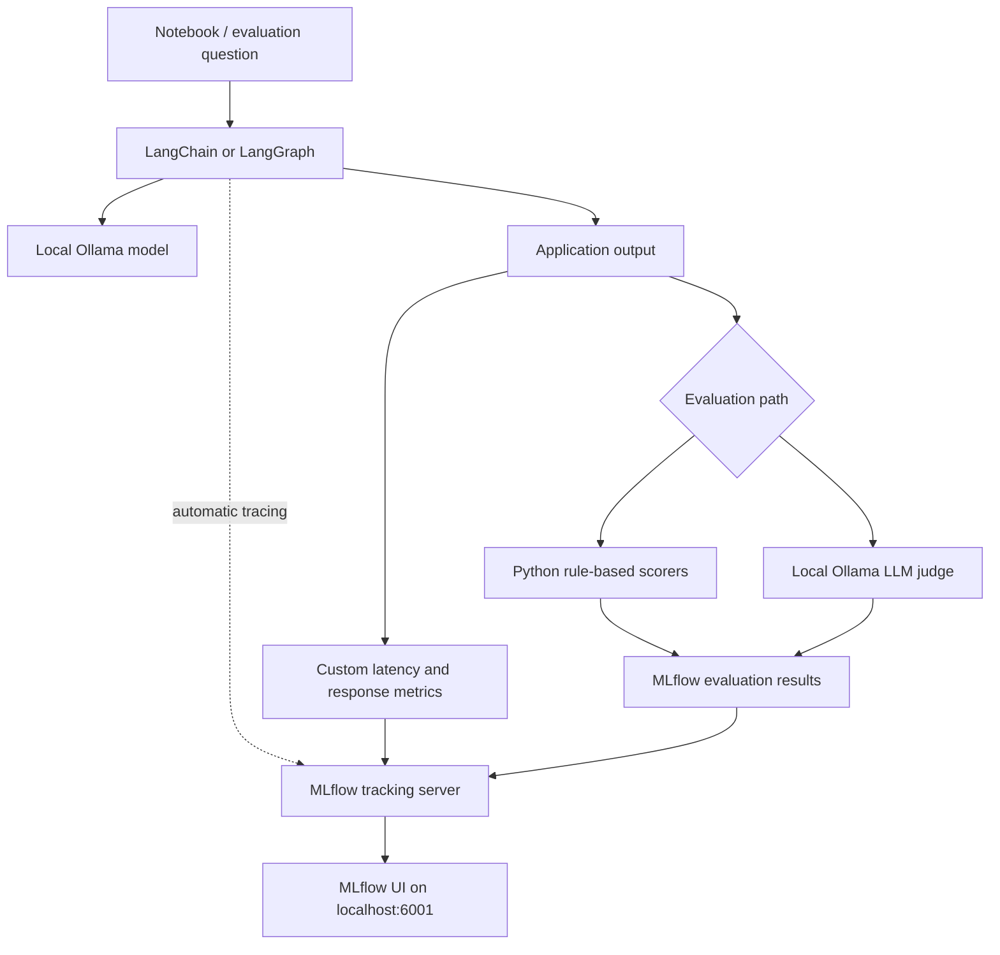

# AI Agent Monitoring & Evaluation with MLflow + LangChain + Ollama

**A six-part, hands-on tutorial for tracing, evaluating, and monitoring local LLM applications and AI agents — without requiring paid cloud LLM API keys.**

[Explore the GitHub repository](https://github.com/konan1805/mlflow-langchain-evaluation) · [MLflow](https://mlflow.org/) · [LangChain](https://python.langchain.com/) · [Ollama](https://ollama.com/)

This project explores how to build small LangChain and LangGraph applications with **Ollama**, record their execution with **MLflow**, and evaluate their behavior using both deterministic checks and a local **LLM-as-a-judge**. It progresses from a simple prompt-to-model chain to tool-using agents, monitoring, and a lightweight retrieval-augmented generation (RAG) pipeline.

> **Project status:** Educational notebooks / local experiments. The examples are not a deployed production monitoring or evaluation service. Results depend on the local models and execution environment.

## At a glance

| Capability | Implementation in this tutorial |
| --- | --- |
| **Tracing** | MLflow automatic instrumentation of LangChain chains and LangGraph agents |
| **Agent observability** | ReAct-style agent using three local demo tools |
| **Custom evaluation** | Deterministic scorers using `mlflow.genai.evaluate()` |
| **LLM-as-a-judge** | Separate Ollama judge with score/rationale feedback |
| **Monitoring** | Per-request latency and response metrics, plus session aggregates |
| **RAG evaluation** | Top-k keyword retrieval, answer generation, and heuristic scoring |

> **Local-first:** Models run through Ollama on your machine. MLflow runs locally too. Any `OPENAI_API_KEY="dummy"` value appearing in notebook code is a compatibility placeholder, **not** a real cloud credential.

## Why this project?

LLM applications can produce plausible responses while failing in ways that basic functional tests don't reveal. For example, an agent might select the wrong tool, a response may lack an expected fact, or a RAG answer might be unsupported by retrieved context. This series practices two complementary engineering disciplines:

- **Tracing and observability:** Understand what executed, including chain and agent steps, tools, latency, and experiment metadata.
- **Evaluation:** Assess response quality and behavior against small datasets with custom rules and local-model judges.

The goal is to learn the building blocks of a repeatable evaluation workflow, not to claim that a few passing examples establish production reliability.

## What is covered?

| Part | Notebook | Main topic | Hands-on implementation |
| --- | --- | --- | --- |
| 1 | [`1_basic_tracing.ipynb`](1_basic_tracing.ipynb) | Basic tracing | LangChain `PromptTemplate \| OllamaLLM`, MLflow tracking server, `mlflow.langchain.autolog()`, traced Q&A run |
| 2 | [`2_agent_tracing.ipynb`](2_agent_tracing.ipynb) | Agent tracing | LangGraph ReAct agent with calculator, current-date, and local knowledge-stub tools; tracked and tagged runs |
| 3 | [`3_custom_evaluation.ipynb`](3_custom_evaluation.ipynb) | Rule-based evaluation | Five-question evaluation dataset; `mlflow.genai.evaluate()`; concise, non-empty, keyword, and no-apology scorers |
| 4 | [`4_llm-as-a-judge_evaluation.ipynb`](4_llm-as-a-judge_evaluation.ipynb) | LLM-as-a-judge | A separate local Ollama judge evaluates correctness, helpfulness, and response language using MLflow scorers and `Feedback` |
| 5 | [`5_monitoring_dashboard.ipynb`](5_monitoring_dashboard.ipynb) | Monitoring metrics | Per-request latency, response length, word count, error count, plus session-level aggregate metrics and run tags |
| 6 | [`6_rag_pipeline_evaluation.ipynb`](6_rag_pipeline_evaluation.ipynb) | RAG evaluation | Small in-memory knowledge base, keyword-overlap retriever, context-grounded LangChain prompt, and heuristic evaluation |

**Recommended order:** Work through the notebooks from **1 → 6**. Each introduces a new concept, rather than relying on a shared application running across all notebooks.

## Conceptual architecture



For **Part 2**, LangGraph may invoke the calculator, date, or knowledge-stub tool as part of answering a question. For **Part 6**, a keyword retriever selects context from the in-memory corpus before the LangChain prompt is sent to Ollama. Not every component in this diagram is used by every notebook.

## Technology stack

| Technology | Role |
| --- | --- |
| Python / Jupyter | Interactive experiments and tutorial notebooks |
| [uv](https://docs.astral.sh/uv/) | Python environment and dependency management |
| [Ollama](https://ollama.com/) | Serve local language models over `localhost:11434` |
| [LangChain](https://python.langchain.com/) | Prompt templates, model calls, and chains |
| [LangGraph](https://langchain-ai.github.io/langgraph/) | ReAct-style tool-using agent (Part 2) |
| [MLflow](https://mlflow.org/) | Tracking server, automatic tracing, evaluation, metrics, and UI |

The examples specify **`qwen3.5:0.8b`** in most notebooks and **`deepseek-r1:1.5b`** as the judge in Part 4. Parts 1 and 2 currently instantiate **`qwen3.6`** in code despite describing or tagging **`qwen3.5:0.8b`**. Before running, use an Ollama model name that is actually installed and make the model strings and tags consistent.

## Prerequisites

- Python and `uv` installed.
- Ollama installed and working locally.
- Cursor, VS Code with Jupyter support, or JupyterLab to open `.ipynb` files.
- Sufficient memory/CPU for your chosen local model(s); Part 4 calls an additional judge model.

### 1. Install Python project dependencies

From the project root (where `pyproject.toml` is located):

```powershell
uv sync
```

If you're building the environment from scratch rather than using an existing project lockfile, install the packages used in these notebooks:

```powershell
uv add mlflow langchain langchain-core langchain-ollama langgraph
uv add --dev jupyter ipykernel
```

### 2. Prepare the Ollama models

Start Ollama if it is not already running:

```powershell
ollama serve
```

In another terminal, pull/check models used in the tutorial:

```powershell
ollama pull qwen3.5:0.8b
ollama pull deepseek-r1:1.5b
ollama list
```

Make sure the `model=` values in each notebook match **models available in your installation**. In particular, review the `qwen3.6` references in Parts 1 and 2 before executing those notebooks. Model names and availability can differ across Ollama installations.

### 3. Start the MLflow tracking server

Run this **once**, in its own terminal:

```powershell
uv run mlflow server --host 127.0.0.1 --port 6001
```

Open **http://127.0.0.1:6001** in a browser. The notebooks use:

```python
mlflow.set_tracking_uri("http://localhost:6001")
mlflow.langchain.autolog()
```

> Several notebooks also include a cell that starts an MLflow server using `subprocess.Popen`. Skip that cell when you already have a server running on port 6001 to avoid a port conflict.

### 4. Launch the notebooks

From the project root:

```powershell
uv run jupyter lab
```

Or open the notebooks directly in Cursor and select the Python kernel belonging to this project's `.venv` environment. Follow the cells in order. The Ollama and MLflow services should already be running.

## Quick reference: MLflow APIs

These calls recur throughout the series:

```python
import mlflow
from mlflow.genai import scorer

mlflow.set_tracking_uri("http://localhost:6001")
mlflow.set_experiment("my-experiment")
mlflow.langchain.autolog()                 # Instrument supported LangChain calls

with mlflow.start_run(run_name="my-run"):
    mlflow.set_tags({"environment": "local", "provider": "ollama"})
    mlflow.log_metric("latency_ms", 123.4, step=1)
    mlflow.log_metrics({"avg_latency_ms": 200.0, "success_rate": 0.95})

@scorer
def is_not_empty(outputs: str) -> bool:
    return bool(outputs and outputs.strip())

# Evaluates model outputs against a dataset with custom scorers.
# eval_dataset and qa_predict_fn are defined in Part 3.
# mlflow.genai.evaluate(data=eval_dataset, predict_fn=qa_predict_fn,
#                     scorers=[is_not_empty])
```

### Anatomy of an evaluation dataset

```python
eval_dataset = [
    {
        "inputs": {"question": "What is the capital of France?"},
        "expectations": {"keyword": "Paris"},
    }
]
```

A custom scorer typically consumes `inputs`, `outputs`, and/or `expectations`, then returns a score or MLflow feedback. Examples in Parts 3, 4, and 6 show different scoring strategies.

## Tutorial walkthrough

### Part 1 — Basic LangChain tracing

**Question:** What happens when a simple local LLM chain executes?

This notebook defines a `PromptTemplate`, connects it to `OllamaLLM` using the `|` operator, invokes a short list of questions, and enables `mlflow.langchain.autolog()`. It saves a named MLflow run under the **`basic_tracing`** experiment.

**Core pattern:**

```python
mlflow.langchain.autolog()
chain = prompt | llm

with mlflow.start_run(run_name="basic-chain-demo"):
    answer = chain.invoke({"question": "What is the capital of France?"})
```

**Observe in MLflow:** The `basic_tracing` experiment, its named run, and auto-generated traces associated with model invocations. The notebook runs three example questions.

### Part 2 — LangGraph ReAct agent tracing

**Question:** How do we inspect a workflow in which an agent chooses tools?

This example creates a LangGraph ReAct agent using `ChatOllama` and three demo tools: `calculator`, `get_current_date`, and `wiki_stub`. It executes questions that could require arithmetic, the date, or a short predefined factual lookup, then tags the MLflow run for filtering.

**Demo tools:**

| Tool | Role |
| --- | --- |
| `calculator` | Arithmetic-expression evaluation for demonstration |
| `get_current_date` | Returns the current date |
| `wiki_stub` | Returns predefined facts about selected AI/software topics |

**Observe in MLflow:** Agent interactions, model activity, and tool-call traces, subject to the installed MLflow/LangGraph instrumentation versions.

**Safety note:** The calculator is tutorial code and uses Python `eval()` with restricted builtins. That is **not a sufficient sandbox for untrusted inputs**. Replace it with a safe arithmetic parser before exposing the agent to outside users.

### Part 3 — Evaluation with custom scorers

**Question:** Can we score outputs without calling another model?

A five-question dataset includes expected keywords. The notebook defines a `qa_predict_fn` and evaluates answers using `mlflow.genai.evaluate()` and four custom `@scorer` functions:

| Scorer | Check |
| --- | --- |
| `is_concise` | Output contains no more than 30 words |
| `is_not_empty` | Output is nonblank |
| `keyword_match` | Expected keyword appears in the output |
| `no_apology` | Output avoids selected apologetic or uncertainty phrases |

**Evaluation pattern:**

```python
results = mlflow.genai.evaluate(
    data=eval_dataset,
    predict_fn=qa_predict_fn,
    scorers=[is_concise, is_not_empty, keyword_match, no_apology],
)
print(results.metrics)
```

These are **fast, explainable heuristics**, not comprehensive factual correctness measures. In particular, the absence of an apology does not prove an answer is correct.

### Part 4 — LLM-as-a-judge with a local model

**Question:** How can another language model evaluate response quality?

This notebook evaluates a Q&A chain using **`deepseek-r1:1.5b` via Ollama** as a separate judge. Three custom MLflow scorers assess:

- **Correctness** relative to the expected response (numeric score and rationale).
- **Helpfulness** relative to the user's question (numeric score and rationale).
- **Language check** indicating whether the answer is in English.

The generator is `qwen3.5:0.8b`, while the separate **judge is `deepseek-r1:1.5b`**. The judge receives structured prompts and returns scores with rationales, which the scorers wrap in `mlflow.entities.Feedback` objects. The notebook includes correctness, helpfulness, and language scorers. Judge quality depends on the judge model and prompting; local-LLM scores should not be treated as objective ground truth.

### Part 5 — Production-style monitoring exercise

**Question:** What can we measure about LLM calls beyond the answer itself?

A `monitored_invoke()` wrapper times chain execution and logs **`latency_ms`**, **`response_len`**, **`word_count`**, and **`error_count`** (when applicable) with `mlflow.log_metric`. The example also logs **average latency**, **average word count**, **total requests**, **total errors**, and **success rate** for a simulated session.

**Monitoring pattern:**

```python
mlflow.log_metric("latency_ms", elapsed_ms, step=step)
mlflow.log_metric("word_count", len(answer.split()), step=step)
# Summary values are also logged at the end of the monitoring session.
```

**Observe in MLflow:** Time-series metric values, summary metrics, and tags such as environment/model/provider. This is an **instrumentation exercise**, not a hosted production dashboard or an always-running monitoring system. Token counts are mentioned in the tutorial introduction but are **not directly collected** by the implementation; it logs words and response characters instead.

### Part 6 — RAG pipeline evaluation

**Question:** How can we evaluate a retrieval-augmented answer pipeline?

The notebook creates a small **seven-entry in-memory corpus** about MLflow, LangChain, Ollama, RAG, and MLOps. Its retriever ranks documents using **keyword overlap** and chooses the top two. A LangChain prompt asks the local model to answer using the retrieved context.

The `mlflow.genai.evaluate()` call applies four scorers: non-empty answer, a heuristic named `not_hallucinating`, expected-keyword presence, and acceptable response length (5–100 words).

> **Important limitation:** `not_hallucinating` only checks for selected refusal phrases; it does **not** verify faithfulness to retrieved documents. This tutorial does not include embeddings, vector search, a vector database, or a validated groundedness judge. Those are natural extensions for a future iteration.

## How to explore results in MLflow

1. Navigate to **http://127.0.0.1:6001**.
2. Select the experiment created by the notebook, such as `basic_tracing`, `langchain-ollama-evaluation`, or `langchain-ollama-rag-eval`.
3. Open a run or trace to inspect the available recorded steps, metrics, and outputs.
4. For Parts 3, 4, and 6, examine aggregate and per-example evaluation results where available in your installed MLflow version.
5. For Part 5, inspect metrics such as `latency_ms`, `avg_latency_ms`, `total_errors`, and `success_rate`.

### Screenshots (to add)

Add real screenshots after running the notebooks; the following Markdown paths are placeholders until those image files exist:

```markdown
<!--  -->
<!--  -->
<!--  -->
<!--  -->
<!--  -->
<!--  -->
```

## Troubleshooting

| Issue | What to check |
| --- | --- |
| Ollama connection refused on `localhost:11434` | Start Ollama (`ollama serve` if needed), then confirm `ollama list` works. |
| MLflow UI inaccessible on port `6001` | Start the server with `uv run mlflow server --host 127.0.0.1 --port 6001`; avoid duplicate launches from notebook cells. |
| `model not found` | Check `ollama list` and align each notebook's `model=` value with a model you have pulled. |
| Confusing results or deleted-experiment warning | Confirm the experiment name and existing MLflow experiment state; choose a new name if needed. |
| `OPENAI_API_KEY` configuration warning | Some notebook examples set a dummy environment value for compatibility. This is **not** a real secret or a requirement to use a cloud API. Inspect your installed integration's requirements. |
| LLM judge output cannot be parsed | Inspect the raw response. A judge can return reasoning or text instead of strict JSON, especially with a small model. |
| Evaluation is slow | Reduce the dataset, choose a smaller installed local model, or run fewer judge scorers; model runtime depends on hardware. |
| Notebook cannot find packages | Select the project's `.venv` Jupyter kernel and run `uv sync` from the project root. |

## Engineering lessons and trade-offs

| Choice | Benefit | Limitation / next consideration |
| --- | --- | --- |
| Local Ollama models | Learn without relying on a hosted LLM endpoint | Performance and output quality vary by hardware/model |
| MLflow auto-tracing | Low-effort visibility into LangChain and LangGraph calls | Trace detail depends on library/integration versions |
| Rule-based scorers | Transparent and inexpensive evaluation | Weak at nuanced semantic and factual assessment |
| Local LLM judge | More flexible quality criteria and rationales | Judge bias, inconsistent formatting, and model-dependent scores |
| Handcrafted, small Q&A datasets | Easy to understand and iterate | Not representative of real-world workloads |
| Keyword-based RAG retrieval | Minimal dependencies and easy to inspect | No semantic search; weak on paraphrased queries |
| Local monitoring simulation | Practice metrics, tags, and run comparison | No service-level alerts, concurrency, or production telemetry pipeline |

## Suggested next experiments

- Compare two Ollama models on the **same fixed dataset** and record results consistently.
- Add regression questions, negative cases, and evaluation criteria with clearly defined pass/fail behavior.
- Measure **actual model token usage** when the client exposes reliable usage metadata.
- Replace the RAG keyword retriever with embeddings and a vector store, then evaluate retrieval relevance and answer faithfulness separately.
- Add safeguards and safe arithmetic parsing for agent tools.
- Compare prompt variants or model versions with saved MLflow runs and screenshots.

## Known setup details to check

- **Model naming:** Parts 1 and 2 refer to `qwen3.6` in code but describe/tag `qwen3.5:0.8b` elsewhere. Set the model consistently before running.
- **Single tracking server:** Start the MLflow server once; avoid simultaneously starting it from multiple notebook cells.
- **Versions:** Notebook code uses APIs that can vary across MLflow, LangChain, and LangGraph versions. Use the project's lockfile to keep your learning environment reproducible.
- **No published benchmark scores:** The notebooks demonstrate evaluation methods, but this README intentionally doesn't claim a measured quality score or throughput benchmark across the full series.
- **Not production hardened:** The demo agent calculator and evaluation heuristics are intended for local learning.

## Repository layout

```text
langchain_ollama_mlflow/
├── 1_basic_tracing.ipynb
├── 2_agent_tracing.ipynb
├── 3_custom_evaluation.ipynb
├── 4_llm-as-a-judge_evaluation.ipynb
├── 5_monitoring_dashboard.ipynb
├── 6_rag_pipeline_evaluation.ipynb
├── pyproject.toml              # if maintained in the project
├── uv.lock                     # if generated by uv
└── README.md
```

## Project scope

This is a **hands-on MLflow learning project** built to demonstrate tracing, evaluation, and monitoring concepts with local models. It can serve as a reference for developing more robust observability and evaluation practices in future agentic AI applications.

---

**Repository:** [konan1805/mlflow-langchain-evaluation](https://github.com/konan1805/mlflow-langchain-evaluation)  
**Feedback and contributions:** Suggestions, additional scorers, and improvements to these learning examples are welcome.
